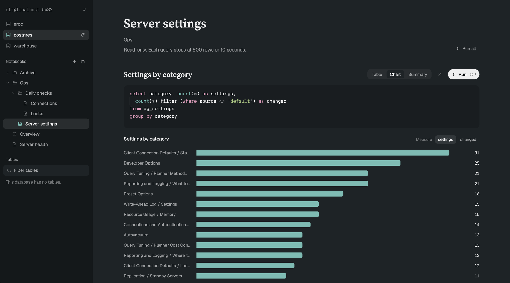

# Postgres Notebook for Herdr

A Postgres browser mod for the [Herdr app](https://herdr.dev). Keep notebooks of SQL queries for each database, sort them into folders, and see each result as a table, a chart or a summary of its columns.



## What it does to your machine

- It runs `psql` on your machine for every query. Sessions are read-only (`default_transaction_read_only=on`). It never asks for a password: put one in `~/.pgpass`.
- Queries have no time limit of their own. Herdr stops any program after 10 minutes.
- A result shows in full up to 50,000 rows, or fewer when rows are wide. All of Herdr's mods share a small script memory, so the notebook holds only so much at once across its tabs. When a result does not fit, the notebook asks what to do with it: show its first rows, save all of it as CSV, or discard it.
- psql writes each result to a temporary file in `~/.config/herdr-app/data/pg/`. The mod deletes the file once it has read it. For a result too big to show, it keeps the file until you save or discard the result, run the query again or close the tab. A file left behind by a crash goes after a day.
- It saves notebooks to `~/.config/herdr-app/pg-notebooks/<server>/<database>.json`. It saves a query's result only when you choose **Save all as CSV**: then psql's file moves to `~/Downloads/<query title>.csv`.
- It reaches nothing on the network except the Postgres server you name.

## Install

1. Install the PostgreSQL client (`psql`).
2. Copy `mods/pg/` into `~/.config/herdr-app/mods/`. If you already have a mod called `pg`, rename the folder, and rename the `mods/pg/` paths inside it to match.
3. Restart Herdr once, so it loads the serif font in `mods/pg/fonts/`.
4. Open a tab: `herdr-app do tab.new --mod pg --name "pg: mydb" --props '{"database":"mydb"}'`. Click the server line at the top left to set `user@host:port`.

`RECIPE.md` describes the mod in full, for anyone who wants to build it again from scratch.

## Tests

```sh
cd mods/pg && node --test
```

The font, Source Serif 4, is © Adobe and licensed under the SIL Open Font License (`mods/pg/fonts/OFL.md`).
