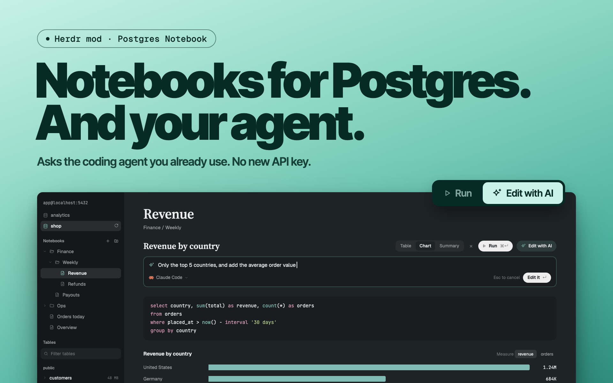

# Postgres Notebook

A Postgres browser for the Herdr app. Each database gets a tab. On the left, an explorer lists the databases on your server, your saved notebooks in folders, and the tables. On the right, the open notebook reads as one page of SQL queries, each shown as a printed table, a chart or a column summary. Three buttons ask your own coding agent to write a query from plain words, fix one the server refused, or change what a result shows. Every session starts read-only, and a result too big to show can be saved whole as CSV.

## What you see

The tab has two parts side by side.

**Explorer** (left, 272px, `theme().chrome`), top to bottom:

1. **Server.** One line in mono, 12.5px, showing `user@host:port`, with a small pencil. A click turns it into a text field with an accent border. Under the field, dim text says "Enter connects. Esc cancels." A bad value shows "Use user@host:port, for example app@localhost:5432." in `ansi1`.
2. **Databases.** One 30px row each, with a database icon at 15px. The open one has a `selected` background and an accent icon. The list scrolls past seven rows.
3. **Notebooks.** A heading with two icon buttons, + (new notebook) and folder-plus (new folder). Below it is a tree of 30px rows, indented 16px a level: chevron (folders only), folder, open folder or page icon at 14px, then the name. Folders come first, then notebooks, each sorted by name without regard to case. The open notebook has a `selected` background. A "…" button shows on hover.
4. **Tables.** The heading has a reload button, a 22px square with a 12px arrow that turns into a spinner while loading. Below the heading is a filter field (32px, `theme().background`, accent border while typing). Under it are schema groups, and table rows with their size on disk in mono, 11px. A chevron shows a table's columns, each with a type mark and a key for primary-key columns.

**Notebook page** (right, `theme().background`, 56px side padding, content at most 1040px wide, 44px between sections):

- The notebook's name in Source Serif 4, 36px, semibold. Under it, its folder path in muted text (`Ops / Daily checks`) and "Read-only. Nothing here can change the database." On the right, **Run all**.
- Each query has:
  - A title row: the title in Source Serif 4, 22px; the **Table · Chart · Summary** switch, which shows once there are rows; a × to remove the query; the **Run** pill (`solid`, with ⌘↵); and **Edit with AI** (see below).
  - The SQL block: editable, `theme().canvas`, radius 12, a 55% accent border while focused, soft wrap.
  - Then the error ("The query failed" in `ansi1`, the message in mono), "No rows.", or the result in the chosen view. Last comes the result line, for example `50 rows · 4 columns · 33 ms`.
  - A result too big to show in full gets a question instead of a view: an `ansi3` dot and "This result is too big to show in full", then "As CSV it is 152 MB. Herdr can show its first 30,000 rows.", then three 28px buttons: **Show the first 30,000 rows** (play icon, `foreground` at 7%), **Save all as CSV** (download icon) and **Discard** (trash icon). After Show, the result line reads `First 30,000 rows of a 152 MB result · 5 columns · 5946 ms · Save all as CSV`. After Save, it says `Saved whole to ~/Downloads/<title>.csv`. After Discard, the query says "Discarded a 152 MB result."
- At the end, **Add a query** and **Ask AI for a query** side by side. An empty notebook says "Click a table on the left, add a query, or ask AI to write one."

**AI parts**, each marked with a sparkle (`icons/sparkle.svg`, in `accent`):

- **Edit with AI**, right of **Run**: a pill 30px high, 12px side padding, fully rounded, 12.5px medium, sparkle 13px. `foreground` at 6%; `accent` at 16% while its box is open or on hover.
- **Ask AI for a query**: a page-foot button like **Add a query**, sparkle 12px.
- **Request box**: in place of the page foot (a new query) or under the query's title row (an edit). `canvas`, radius 12, a 55% `accent` border. First row: sparkle 15px and a 28px field at 14px, with the placeholder "Describe the query you want, in your own words" or "What should be different in its results?". Second row: the agent picker (agent icon 14px and name, a chevron when two or more are installed), then "Esc to cancel" (12px, `dim`) and a `solid` pill, **Write it ↵** or **Edit it ↵**.
- **Agent menu**: 220px, `popover`, the heading "Ask with", then 30px rows with icon and name, and a check on the chosen agent.
- **Job line**, between the title row and the SQL block while an agent works: radius 12, its color at 9%, a spinner (`spin(800)`) or a 7px dot, a 13.5px headline and a 12.5px muted detail, then **Watch** (**Open** while it waits) and **Stop** (**Dismiss** after a failure). The texts: "Starting Claude Code…"; "Claude Code is writing / editing / fixing this query", with the request in quotes; "Claude Code needs you" / "Open it to see what it asks."; "Claude Code stopped without an answer"; "Claude Code has not started" / "Open it: it may be asking something first."; and the failures "Could not start …", "… could not do it: <its reason>", "… closed without an answer." and "… wrote an empty answer."
- **Done line**, under the SQL block: sparkle 12px, "Written by …", "Fixed by …" or "Edited by …: “<request>”", then "· Undo" for fixes and edits, and an 18px × that hides the line.
- **Fix with AI**, under an error the server raised about the query: a 28px button, `accent` at 12%, sparkle 13px.
- With no agent installed, asking shows a notice, "No coding agent to ask", saying Herdr is still checking, or to install one such as Claude Code or Codex.

## How it behaves

- **Opening.** Tab props are `{ database, notebook? }`. A tab opens `notebook` if given, else the database's last opened notebook, else the first one. Opening a notebook runs all its queries at once, and each result shows as it lands. A database with no notebook file gets an **Overview** notebook with two queries on Postgres's own catalog: "Tables by size" and "Settings by category".
- **Databases.** A click on another database goes to that database's tab, or opens one named `pg: <database>`.
- **Server.** Enter on a good value saves it to the shared key `pg.server`, and every pg tab follows. Each server keeps its own notebooks.
- **Tables.** A tab reads its tables once, when it opens. The reload button by the Tables heading reads the databases, tables and sizes again, after a dbt run for example. A click on a table adds `select * from schema.table limit 100` to the open notebook and runs it. With no notebook open, it first makes one named after the table. A click on a column adds its name to the query you last edited.
- **Tree.** A folder row or its chevron folds the folder open or shut. A notebook row opens it. A right-click, or the "…" button, opens a menu under the row (180px, `popover`) with Rename, Move to…, Duplicate (notebooks only) and Delete:
  - Rename turns the row into a text field. Enter or a click elsewhere saves. Esc cancels. An empty name is refused.
  - Move to… opens a small list under the row: "Top level" and every folder. It leaves out the item itself and anything inside it, and marks the current place with "here".
  - Duplicate makes "<name> copy" beside the notebook and opens it.
  - Delete removes a folder at once and moves its contents up one level. For a notebook, the row asks first: "Delete <name>? Delete / Keep".
- **Titles.** A click on the page title or a query title edits it in place. A query title left empty, or the same as the automatic one, stays automatic. The automatic title is the table the query reads, in words ("Order items").
- **Big results.** A query runs until it ends, up to the 10 minutes Herdr allows any program. One result holds at most 50,000 rows, 250,000 values and 16 MB of text. Every result in every pg tab holds at most 400,000 values and 24 MB together, and the room goes to whichever result is read first. A result that does not fit keeps psql's file and asks: Show the first rows (already read, so it shows at once), Save all as CSV (moves the file to `~/Downloads/<title>.csv`, adding " 2", " 3" when the name is taken), or Discard (deletes the file). Running the query again or closing the tab deletes it too, and files a day old go when a tab opens.
- **Views.** Until you pick one, a result that charts well, with more than one row, opens as Chart. Anything else opens as Table. Your pick is saved with the query.
- **Charts** come from column kinds only:
  - a number over a date: bars on a real time axis;
  - a number per text label: horizontal bars, largest first, top 16, then "and N more, smaller";
  - two numbers: a scatter;
  - one number: a 20-range histogram;
  - text only: rows per value;
  - dates only: rows over time.

  Identifiers, code, prose and URLs never become an axis. When there are several numbers, **Measure** chips pick one, and the chip saves the column's name. Bars are at most 24px thick, 2px apart, rounded 4px at the data end. Gridlines sit at 0, 50% and 100%, with a 52px y-axis. Every bar and dot has a tooltip. One series uses one color: `ansi4`, and `accent` on hover. When two time points are closer than a fiftieth of the span, they are summed into 50 equal slices, and the chart says so.
- **Summary.** One line per column: name, what it holds (numbers, dates, yes or no, JSON, code, categories, identifiers, text), filled %, distinct count, then range and average, or the most common value.
- **Table.** Rules above and below, no vertical lines. Numbers sit on the right in mono. Ids and code are in mono and muted. Dates read as "Nov 11 · 21:05". Empty values show "—". Booleans read as true or false.
- **Asking an agent.**
  - **Agents.** Each tab calls `knownAgents()` once and keeps the installed ones. The pick is the shared key `pg.agent`; with none picked, the first in the list, which is the one started most.
  - **Asking.** Enter or the pill sends; Esc, or the button again, closes the box. A new query is added first, its SQL the request as `-- ` comment lines, then the job starts. Each query has at most one job; a new one stops the old one. Removing a query, changing the server or closing the tab stops its agent.
  - **The brief** goes to `<appHome>/data/pg/ai/jobs/<id>.md`: the database and server, the read-only psql command (`psql -X -w -d '<conninfo>'`), up to 400 `schema.table` names (or that there are none, or that they are still loading), the notebook's other queries up to 6,000 characters, the task, and the rules for the answer: run the query once with psql; write one statement to `answers/<id>.sql`, whose first line may be `-- title: …` (new queries only); or write why not to `answers/<id>.txt`; end a query that lists rows with `limit 100`; never change the database. A fix sends psql's whole error; an edit sends the query and its last result's columns and row count.
  - **Starting.** `hc run --bg --json --no-parent --rm --name pg-<id> --cwd <dir> --label pg.job=<id> -- <agent.run…> "Read <brief> and do what it says."` The terminal is in no tab; **Watch** and **Open** run `terminal.peek` on it.
  - **Following.** Every second while a job runs: an `.sql` answer is applied; a `.txt` answer fails the job with its text; a terminal that is gone fails it; 8 seconds without a word from the agent shows "has not started". The phase comes from `terminals()`: not live is gone; `blocked`; `idle` or `done` after a turn is stopped; `working`; anything else is starting.
  - **Applying.** Take off a Markdown fence and the title line, write the SQL (and, for a new query, the title) as a document step so it saves and other tabs follow, run it if that notebook is shown, stop the terminal, and delete the brief and the answers. The old SQL and title stay in memory for **Undo**, which writes them back and runs the query.
  - **Fixable errors.** psql's message holds `ERROR:` and none of: read-only transaction, statement timeout, canceling statement, permission denied, out of memory.
  - **First run.** The mod writes `<dir>/.claude/settings.json` if it is missing, allowing `Bash(psql:*)`, `Read(./**)` and `Edit(./answers/**)`, so Claude Code needn't ask each time.
- **Saving.** Notebooks save to `~/.config/herdr-app/pg-notebooks/<server>/<database>.json` about 600ms after the last change. Results are never saved. Two tabs on the same database stay in step: a rename in one shows in the other within two seconds. A file that does not parse is kept as `<database>.json.corrupt-<time>`, and a notice says so.

## Built from

- **Mod:** `mods/pg/`, with `mod.json` `{ "place": "none", "title": "Postgres Notebook" }`. It runs in tabs, opened by `tab.new {mod: "pg", name: "pg: <db>", props: {database}}`.
- **Optional sidebar list:** the same mod with props `{ "view": "panel" }`, put in a layout's sidebar column, lists the databases. A click opens or selects that database's tab.
- **Files:**
  - `logic.js` holds the server text, psql arguments, CSV (`readCsv` stops after a number of values and says where to go on), catalog SQL and quoting.
  - `result.js` reads a result a slice at a time within the room left, and names the saved file.
  - `notebooks.js` holds the file shape, ids, the path rule, checking a file, tree steps and sorting.
  - `shape.js` holds value kinds, column profiles, chart choice, time slices, histograms and formatting.
  - `store.js` holds reading and writing the file.
  - `main.js` holds the view's state and actions.
  - `ai.js` holds the brief, reading the answer, the agent's phase and which errors are fixable; `ai.test.js` tests it.
  - `assistant.js` starts agents, follows their jobs and applies the answers.
  - `ui/*.js` draws; `ui/ai.js` draws the AI parts.
  - `ai.js`, `logic.js`, `notebooks.js`, `result.js` and `shape.js` have no app imports, and `node --test` runs their tests.
- **Programs:** `psql`, with `-X -w --csv` and a read-only session (`default_transaction_read_only=on`). For a query, psql writes the rows to a temporary file (`-o`, in `~/.config/herdr-app/data/pg/`), which skips `exec`'s 8 MiB output cap. `exec` gets `timeout: 600000`, the most Herdr allows. `wc -c` gives the file's size; `head -c` copies out the first 16 MB of a bigger one; `mkdir -p` and `mv -n` save it; `find -mmin +1440 -delete` clears old ones.
- **Agents:** `hc run` starts one per job (see How it behaves); `hc kill` stops it.
- **herdr:** `knownAgents`, `hc`, `terminals`, `run("terminal.peek")`, `exec`, `readTextFile`, `writeTextFile` (with `expected`), `watchFolder`, `notify`, `appHome`, `home`, `shared`/`setShared` (`pg.server`, `pg.agent`), `run` (`tab.select`, `tab.new`), `spaces`, `theme`, `settings`, `props`.
- **gpui-base:** `EditorState`/`Editor` (SQL, soft wrap), `InputState`/`Input`, `v_virtual_list` with `Scrollbar` (the result table), and `Popup` (the row menu, anchored `top_right`; the agent menu, anchored `top_left`).
- **File shape (version 1):** `{ version, server, database, lastOpened, folders: [{id, name, parent, open}], notebooks: [{id, name, folder, created, updated, queries: [{id, title, sql, view, measure}]}] }`. `view` is null, "table", "chart" or "summary". `measure` is a column name or null.
- **Art:** `icons/*.svg` (24 viewBox, stroke 2, round caps, `currentColor`). `fonts/` holds Source Serif 4 Regular and Semibold (SIL OFL, `fonts/OFL.md`).

## Watch out

- Every change is a step from one document to the next, kept until a write lands. `writeTextFile` refuses a stale write. Then read the file again, replay the unsaved steps on top of it, and write once more. A step that no longer applies (its item is gone) must return the document unchanged.
- The SQL block being typed in must not take SQL from another tab's write. Every other block does.
- The mod's script engine ignores `localeCompare` options and compares by code point. Sort on `toLowerCase()`. A Node test will not catch this.
- The engine is far slower than Node at character loops and regexes. Parse CSV with `indexOf`, not character by character. Base the column guesses (ids, code, prose, labels) on the first 2,000 rows, and count filled and distinct values over all rows. Read times by position, not with regexes. `Math.min(...values)` overflows on a few hundred thousand values, so use a loop.
- The engine stops a task that runs more than about half a second without an `await`, and says nothing: the query just stays on "Running". Read a result in slices with `await cx.sleep(0)` between them.
- A `render` that runs past about 50 ms is interrupted, and the tab shows "This view could not be re-rendered". So work out column widths, the summary and the chart for every measure in the task, before the result shows, and let `render` only read them.
- All of Herdr's mods share one script heap of about 200 MB. Past it, the engine throws "out of memory", or `null` when it cannot even build the error. `fs.readFile` refuses files over 64 MiB. Hence the limits above, counted across tabs in module scope, which every copy of the mod shares.
- Every pg tab runs in the same engine, so code that runs after an `await` can be inside another tab's call. A task started there belongs to that tab and redraws it, and `cx.spawn(…, { owner: this })` throws. Run every task on one worker started in `init`, whose `cx` stays with its own view.
- Saving a mod file reloads it, and the replaced build gets no `close()`: its results stay in memory until Herdr restarts. Restart after editing the mod a lot.
- `"transparent"` is not a color. Use `"#00000000"`.
- `cx.notify()` throws during `render`, and `EditorState.new`/`InputState.new` only work in `init`, handlers or spawned tasks.
- The root takes focus on mouse down, so text fields and SQL blocks stop the mouse down from reaching it.
- Menu rows act on `on_mouse_down`, not `on_click`.
- Text wraps only when every flex parent has `min_w(0)`.
- The SQL block's height counts wrapped lines: about 8.2px per character at 13.5px mono, and 24px per line, measured with `on_size_change`.
- psql gives booleans as `t`/`f` and nulls as `<<NULL>>`. Values over 600 characters are cut.
- Fonts in `fonts/` load when Herdr starts or the look changes (theme or zoom).
- `herdr-app check` renders once with no notebook loaded. Look at the real thing with `herdr-app shot`.
- Writing notebooks under `mods/` would reload the mod on every save. Keep them in `pg-notebooks/`. The same goes for the agents' work folder: keep it under `data/`.
- Read-only is a default, not a lock: `default_transaction_read_only` sets how each transaction starts, and a query that asks for a read-write transaction can write. The agent also has a shell. Only a role that can only read makes a database safe.
- Claude Code asks once whether to trust its work folder, and looks idle until someone answers. Hence the 8-second hint and **Open**.
- Read the agent's answer from the file it writes, never from its screen.
- A job can finish after the person opens another notebook. Apply the answer to the document by notebook id, and run the query only if that notebook is shown.
- Jobs and done lines live in each tab's memory: a reload or a closed tab drops **Undo**.

## Done when

1. `node --test` passes in `mods/pg/`, and `herdr-app check mods/pg` passes.
2. On any database: make two folders, one inside the other; make three notebooks; rename one; move one into the inner folder; duplicate one; delete the outer folder and see its contents move up; delete a notebook after the inline question.
3. After quitting and restarting Herdr, the folders, notebooks, queries, chosen views and measures are all there, and the tab opens on the last notebook.
4. Two tabs on the same database: a rename in one shows in the other within two seconds.
5. Each of the six chart types appears for a query of that shape. A failing query shows its error. An empty result shows "No rows."
6. A query returning 60,000 rows asks whether to show its first 50,000. Show draws them as a chart without "This view could not be re-rendered". Save all as CSV puts the whole result in `~/Downloads`. Discard deletes its file. A 2-million-row query in the same notebook gets the room that is left. A query that runs for 12 seconds finishes.
7. Changing the server in the explorer switches to that server's notebooks.
8. `node --test` passes `ai.test.js`.
9. **Ask AI for a query** with "How many connections does each database have right now?" adds a titled query that runs.
10. A `selec` typo shows **Fix with AI**; the fixed query runs; **Undo** brings the typo back.
11. **Edit with AI** changes a query in place, and **Undo** restores it.
12. **Watch** opens the agent's terminal over the tab; **Stop** ends it and the line goes.
13. In a new work folder, Claude Code's trust question shows as "has not started" within 10 seconds, and answering it lets the job finish.
14. A permission-denied error has no **Fix with AI**.
15. After closing the tab, `hc ls --json` lists no terminal labelled `pg.job`.
